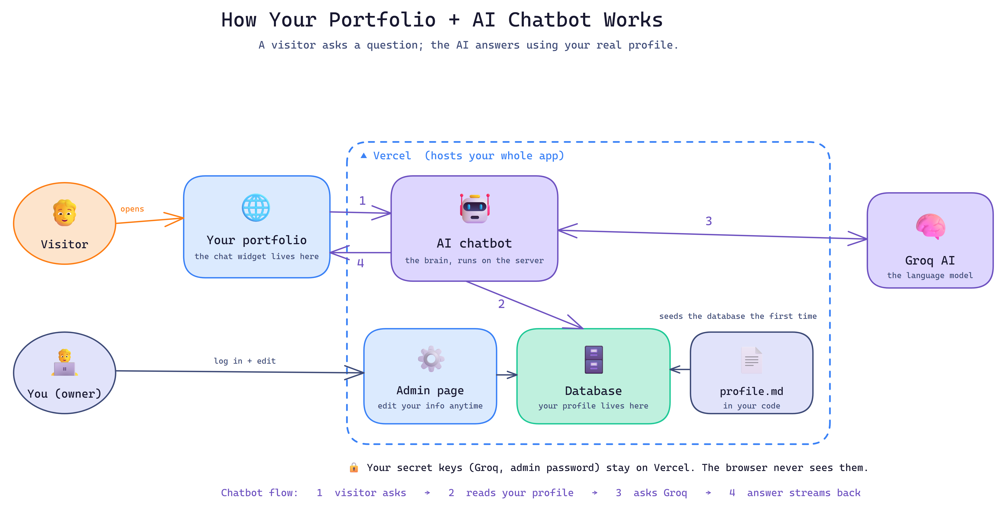

# Project Background

The current portfolio website limits me from adding more projects and is restricted to only certain type of projects. Also the complete focus is only on projects.

The plan is to build a portfolio website which puts all my experience, skill, projects, github profile and LinkedIn profile at one place, plus a chat bot that answers on behalf of me about me. Focus here is not only the projects but also to showcase my entire work experience.

# Implementation Plan

- Wrote the scope of the project in plain english, describing the requirements of the website and chatbot.

- Generated the PRD in .md file format by providing the above project scope to Chat GPT.

- Uploaded the above generated PRD to Antigravity IDE developer tool and asked the agent to brake the PRD to multiple phases and built the website phase by phase.

- Tested each phase after completion and fixed the issues before implementing the next and improved certain features alongside issue fixes.

# Process (How it works)

# Output

Created a website with a chatbot that answers on behalf of me. The website has all my information: Experiences, Skills, Projects, Github profile and LinkedIn profile.

